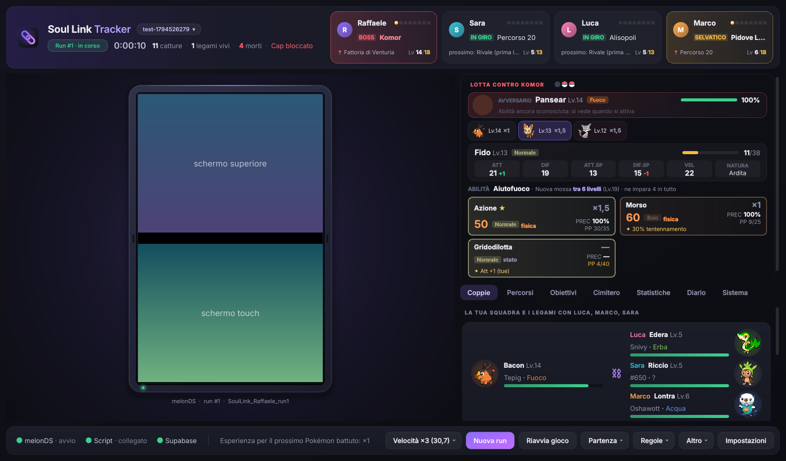
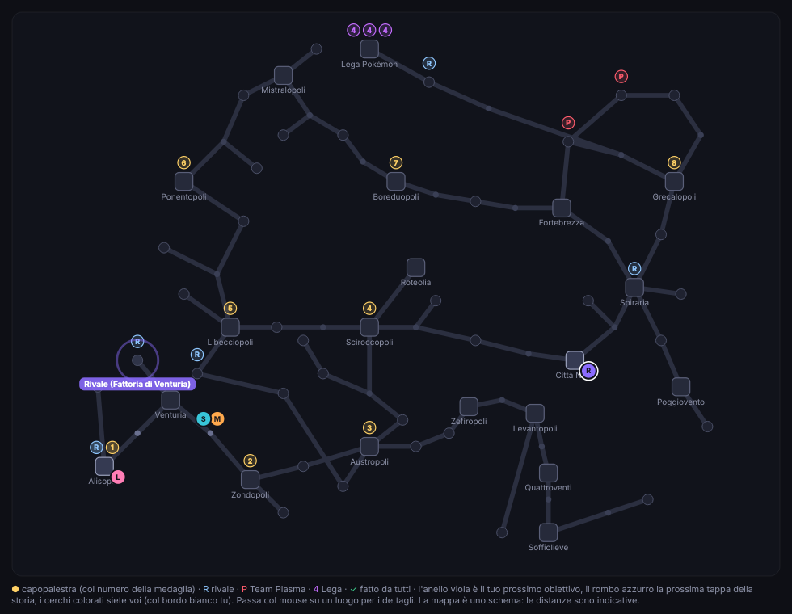
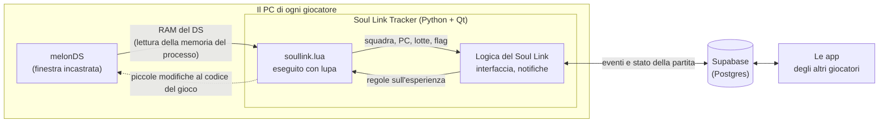

# Soul Link Tracker

**Un'app per Windows per giocare una Randomizer Soul Link Nuzlocke di Pokémon Nero 2 / Bianco 2, da 2 a 4 giocatori.**

L'emulatore (**melonDS**) gira dentro l'app. L'app legge la memoria del gioco e segna da sola incontri, catture, morti e lotte importanti. Applica le regole del Soul Link per tutti e tiene la partita sincronizzata con gli amici tramite un piccolo database gratuito su Supabase. Non serve un sito, non ci sono porte da aprire sul router e gli altri non devono essere online.



> 📖 La **guida completa** (configurazione passo passo, tutte le funzioni, domande frequenti) è in [LEGGIMI.md](LEGGIMI.md). Le novità dell'ultima versione sono in [NOVITA.md](NOVITA.md).

---

## Cos'è un Soul Link

Ogni giocatore ha la sua ROM randomizzata e fa una Nuzlocke: un solo Pokémon catturabile per zona, e chi va KO è morto per sempre. In più i Pokémon catturati nello stesso luogo dai diversi giocatori sono **legati**:

- se ne muore uno, muoiono anche tutti gli altri del gruppo;
- se un giocatore fallisce l'incontro, il gruppo si rompe e gli altri finiscono nel box;
- in squadra si possono tenere solo Pokémon il cui gruppo è ancora intero.

Tenere tutto questo a mano tra quattro persone è un lavoro. L'app lo fa da sola.

## Cosa fa

**Il gioco**
- 🎮 **melonDS incastrato nell'app**, al centro di una cornice che ricorda la console, con i due schermi uno sopra l'altro. La prima volta l'app lo scarica da sola, e usa una copia sua che non tocca un melonDS che usi per altro.
- 🎲 **ROM randomizzate automatiche**: a ogni nuova run l'app genera la ROM con Universal Pokémon Randomizer ZX (stesse impostazioni per tutti) e la carica.
- ⏩ **Si salta l'inizio**: ogni run riparte dal salvataggio fatto prima dello starter.
- 💾 **Backup** del salvataggio ogni 10 minuti e a ogni chiusura, con il ripristino a un clic.
- 🔈 **Volume e velocità dall'app**: cursore del volume (parte dal 5%) e avanti veloce ×2…×8, anche mentre giochi.

**Il tracker**
- 🔎 **Incontri e catture riconosciuti da soli**: luogo, primo incontro, cattura o fuga, clausole doppioni e shiny.
- 🔗 **Coppie e gruppi** di ogni luogo con lo stato di ognuno (vivo, box, morto, addormentato, scottato…), aggiornati in tempo reale anche durante le lotte degli amici.
- ⚔️ **Tracker della lotta**:
  - per l'avversario: abilità (quando si vede), modifiche alle statistiche ed efficacia di ogni tua mossa;
  - per il tuo Pokémon: statistiche con natura, tra quanti livelli impara una mossa;
  - per ogni mossa: potenza, precisione ed effetti secondari.
- 🏆 **Obiettivi della storia**: le 20 lotte importanti di Nero 2 in ordine, con il level cap che sale da solo, una mappa di Unima e il tempo come negli speedrun.
- 📍 **Dove sei**: allenatori ancora da battere e strumenti ancora da raccogliere nella zona, letti dalla ROM.
- 🔔 **Notifiche** di morti, legami rotti, catture libere nella zona, lotte con i capipalestra e Pokémon in pericolo.
- 📊 **Statistiche** di ogni run e record tra una run e l'altra; diario e cimitero.

**Regole opzionali** (dal menu *Regole*)
- Level cap bloccato: l'esperienza si ferma al cap anche se un Pokémon salirebbe di due livelli.
- Esperienza solo dagli allenatori (dai selvatici zero).
- Condividi esperienza ridotto (×½, ×¼, ×⅛).

**La partita condivisa**
- 👥 Da 2 a 4 giocatori, ognuno sul suo PC. Bastano un **codice della partita** e un progetto Supabase gratuito.
- 🗂️ Più partite in parallelo (un Soul Link con un gruppo, un altro con un altro gruppo).
- ⬆️ **Aggiornamenti automatici**: quando esce una versione nuova l'app la scarica e si riavvia da sola.



## Cosa serve

| | |
|---|---|
| **Sistema** | Windows 10 o 11 (64 bit) |
| **Java** | a 64 bit, per il randomizer ([adoptium.net](https://adoptium.net), "Windows x64") |
| **Randomizer** | [Universal Pokémon Randomizer ZX](https://github.com/Ajarmar/universal-pokemon-randomizer-zx) (`PokeRandoZX.jar`) e un file di impostazioni `.rnqs`, uguale per tutti |
| **ROM** | la tua copia di Pokémon Nero 2 (testata con la versione italiana, `IREI`) |
| **Supabase** | un progetto gratuito su [supabase.com](https://supabase.com), creato da uno del gruppo |
| **melonDS** | niente da fare: l'app lo scarica da sola la prima volta |

## Come si comincia

1. **Uno del gruppo crea la partita su Supabase.** Nuovo progetto gratuito, poi *SQL Editor* → incolla [`supabase/schema.sql`](supabase/schema.sql) → *Run*. Manda agli altri l'URL del progetto, la *Publishable key* e un codice della partita a scelta (es. `drago-luna-4821`).
2. **Ognuno scarica `SoulLinkTracker.exe`** dalla pagina [Releases](../../releases) e lo avvia. Se Windows dice che non è firmato: *Ulteriori informazioni → Esegui comunque*.
3. **Nelle Impostazioni** inserisce il suo nome, i dati di Supabase, Java, il randomizer, il file `.rnqs` e la sua ROM.
4. **Si gioca.** L'app scarica melonDS, genera la ROM della run e apre il gioco. Tasti predefiniti: X/Z = A/B, S/A = X/Y, Q/W = L/R, Invio = Start, Backspace = Select, frecce; il touch screen si usa con il mouse. Per cambiarli: *Altro → Mostra il menu di melonDS*.

I dettagli di ogni passo sono nella [guida completa](LEGGIMI.md#1-supabase-una-volta-sola-lo-fa-uno-dei-due).

## Come funziona dentro



- **Lettura del gioco.** melonDS non ha script interni. L'app apre la memoria del processo di melonDS (`ReadProcessMemory`) e trova la RAM del DS cercando la copia dell'intestazione della cartuccia che il DS tiene a `0x027FFE00`. Poi esegue lo script del tracker (`app/risorse/soullink.lua`) con [lupa](https://github.com/scoder/lupa), offrendogli le stesse funzioni di BizHawk che usava prima (`memory.*`, `emu.framecount`…). I fotogrammi si contano dal titolo di melonDS, quindi i tempi dello script seguono la velocità vera del gioco.
- **Cosa legge lo script.** Squadra e PC (dati dei Pokémon decifrati), zona, medaglie e flag degli eventi (allenatori battuti, strumenti raccolti). Le strutture della lotta (PS, stato, modifiche alle statistiche, mosse) le trova cercandole nella memoria, senza indirizzi fissi. Per le regole sull'esperienza modifica due istruzioni del calcolo dell'esperienza, come un codice Action Replay, solo durante la lotta.
- **Dati dalla ROM.** Nomi di luoghi e allenatori, incontri selvatici, allenatori e strumenti di ogni zona e mosse imparate per livello si leggono dalla ROM randomizzata (archivi NARC, testi cifrati della 5a generazione).
- **Partita condivisa.** Ogni app manda a Supabase solo gli eventi (catture, morti, lotte) e la sua presenza. La partita si ricalcola da quegli eventi con la stessa logica su ogni PC, quindi tutti vedono la stessa cosa e nessun PC deve fare da server.

## Struttura del progetto

```
app/
  main.py               avvio dell'app
  requirements.txt      PySide6, lupa
  risorse/              soullink.lua, dati di Pokémon e mosse (dati.json), icone, font Inter
  sl/
    finestra.py         finestra principale
    melon.py            download, configurazione e finestra di melonDS
    memoria.py          lettura/scrittura della memoria del processo, ricerca della RAM del DS
    script.py           esecuzione di soullink.lua dentro l'app (funzioni "di BizHawk")
    logica.py           regole del Soul Link, obiettivi, level cap
    sincro.py, archivio.py   sincronizzazione con Supabase
    rom.py              lettura della ROM (testi, incontri, allenatori, strumenti, mosse)
    lotta.py, scheda.py, riepilogo.py, pannelli.py, mappa.py   interfaccia
    esperienza.py       regole sull'esperienza (level cap, solo allenatori, Condividi)
    backup.py, run.py   backup, ROM delle run, salvataggio di partenza
supabase/schema.sql     tabelle e funzioni del database
strumenti/              script per generare dati (note delle mosse, icona)
.github/workflows/      crea l'exe e pubblica le release
```

## Sviluppo

```bash
cd app
pip install -r requirements.txt
python main.py
```

L'app gira anche su Linux per lo sviluppo. L'incastro della finestra e l'avanti veloce dal pulsante sono solo per Windows; la lettura della memoria usa `/proc/<pid>/mem`.

**Nuova versione:** aumenta `VERSIONE` in `app/sl/__init__.py`, scrivi le novità in `NOVITA.md` e carica su `main`. Il workflow *Crea exe* costruisce `SoulLinkTracker.exe` con PyInstaller e, se la versione è nuova, pubblica la release: le app di tutti la propongono al prossimo avvio.

## Crediti

- **[melonDS](https://melonds.kuribo64.net)** (GPLv3), l'emulatore. L'app non lo include: lo scarica dalle release ufficiali su GitHub.
- **[Universal Pokémon Randomizer ZX](https://github.com/Ajarmar/universal-pokemon-randomizer-zx)** per le ROM randomizzate.
- **[NDS Ironmon Tracker](https://github.com/Brian0255/NDS-Ironmon-Tracker)** per gli indirizzi di memoria di partenza di Nero 2 / Bianco 2.
- **[PokeAPI](https://pokeapi.co)** per i dati di Pokémon, mosse e abilità e per gli sprite.
- **[PKHeX](https://github.com/kwsch/PKHeX)** come riferimento per il formato dei dati dei Pokémon e dei flag degli eventi.
- Il carattere **Inter** (SIL Open Font License), in `app/risorse/font`.

Pokémon è un marchio di Nintendo, Game Freak e The Pokémon Company. Questo è un progetto amatoriale, non affiliato. Serve una copia legittima del gioco; l'app non contiene ROM.
